# Credit Risk Modelling: Probability of Default with Logistic Regression

An end-to-end study of next-month default among credit card holders, using **logistic regression only**. The project covers data verification, exploratory analysis, a leakage-safe preprocessing pipeline, four regularisation variants, probability calibration, threshold selection and a hypothetical expected-loss sensitivity analysis. Every number and chart in this document comes from executed code in `notebooks/` and is stored in `results/`.

Author: Samrat · GitHub: [wittyswayam](https://github.com/wittyswayam)

## 1. Overview
- **Data:** 30,000 clients of a Taiwanese card issuer, April to September 2005 behaviour; target is default in October 2005 (22.1% prevalence).
- **Models:** baseline, L1, L2 and class-weighted logistic regression. No tree or neural models are used in the main experiments by design.
- **Headline result:** the selected L2 model reaches **ROC-AUC 0.765, KS 0.42, PR-AUC 0.52 and Brier score 0.139 on the held-out test set**, with predicted PDs that match observed default frequencies without recalibration (mean PD 22.1% vs 22.1% observed).

## 2. Research motivation
Logistic regression remains the reference model in credit scoring because its coefficients are auditable and its probabilities can feed provisioning and pricing. The question here is how far a carefully specified logistic model goes, and what has to be checked around it (calibration, thresholds, loss assumptions) before its outputs are usable by a risk function.

## 3. Research questions and short answers
| # | Question | Answer from this project |
|---|---|---|
| 1 | Can logistic regression predict default effectively? | Moderately well: test ROC-AUC 0.765, KS 0.42, against a 22% base rate. |
| 2 | Which characteristics are associated with default? | Recent and repeated payment delays by a wide margin; then lower credit limit, higher latest bill and lower repayments. |
| 3 | How do regularisation and feature selection affect performance? | Almost no effect on discrimination (CV ROC-AUC 0.7641 → 0.7650 at the optimum); large effect on coefficient stability. L1 keeps 29 of 31 features. |
| 4 | Are probabilities calibrated? | The L2 model is: no recalibration was needed. Class weighting inflates mean PD to 43.6% until recalibrated. |
| 5 | How should classification thresholds be chosen? | From the cost ratio of missed defaults to false alarms, not from 0.50. |
| 6 | What do false positives and false negatives cost? | See section 10: the operating point moves from 28% recall at 0.50 to 79% recall at 0.13, at the price of precision falling from 63% to 32%. |

## 4. Dataset
UCI Machine Learning Repository, *Default of Credit Card Clients* (id 350); original study Yeh and Lien (2009), *Expert Systems with Applications* 36(2). 30,000 rows, 23 predictors, one binary target, no missing values. Variable definitions, anomalies and the leakage assessment are in [`docs/dataset_description.md`](docs/dataset_description.md).

The data file is not committed (its redistribution terms were not verified). Run `python scripts/download_data.py` or follow [`data/README.md`](data/README.md); the file goes in `data/raw/`. The SHA-256 checksum of the archive used is recorded there. The sandbox used to build this project could not reach UCI directly, so the file was supplied manually; the checksum was not compared against an independently published UCI hash.

Data issues found and handled openly: undocumented codes in `EDUCATION` (0, 5, 6) and `MARRIAGE` (0), undocumented repayment-status values (-2, 0), a near-absence of the value 1 in `PAY_2` to `PAY_6`, 35 rows duplicated apart from ID (kept) and negative bill amounts (kept).

## 5. Methodology
Full detail in [`docs/methodology.md`](docs/methodology.md).
- **Split:** stratified 60/20/20 train/validation/test, seed 42. Rows are not documented as chronological, so no time-based split is possible.
- **Preprocessing** (`src/preprocessing.py`): scikit-learn `Pipeline` and `ColumnTransformer`; signed-log transform and scaling for amounts, scaling for ordinal and numeric fields, one-hot encoding for categories. All learned parameters come from training data only; a check in notebook 02 confirms it.
- **Features:** engineered utilisation, repayment ratio, worst delay, number of late months and a centred age² term; **SEX is excluded** from the main model on fair-lending grounds, and adds no predictive value (ROC-AUC change of +0.0003).
- **Selection discipline:** the test set was used once, after calibration, risk bands and the threshold had been fixed. Selection rules were written into the notebooks before the relevant results were inspected.

## 6. Exploratory data analysis
Notebook [`01_exploratory_data_analysis.ipynb`](notebooks/01_exploratory_data_analysis.ipynb).

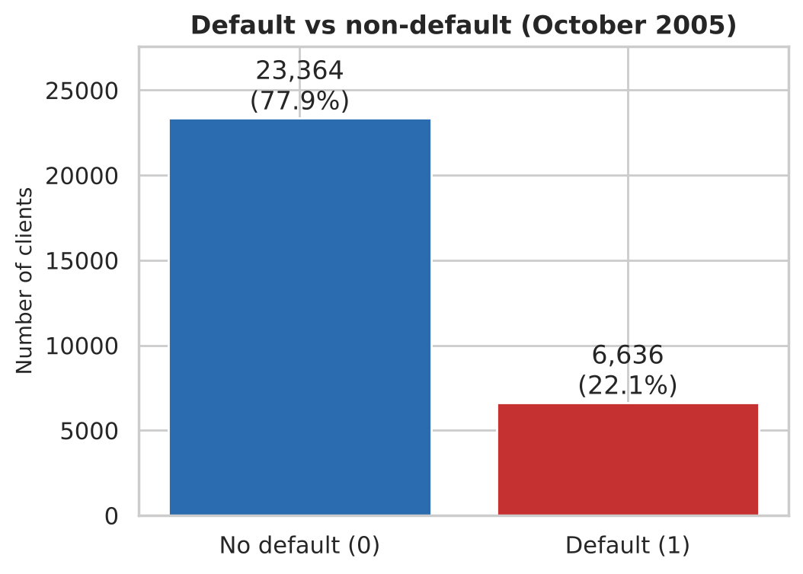
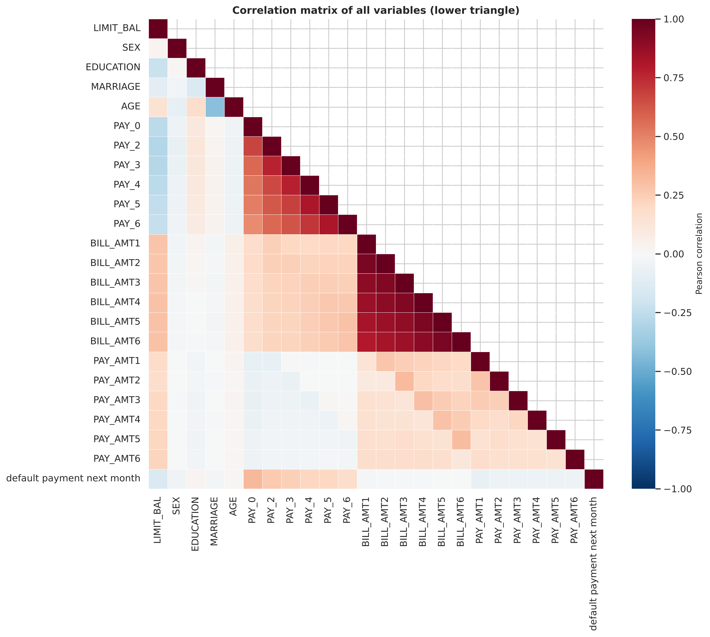
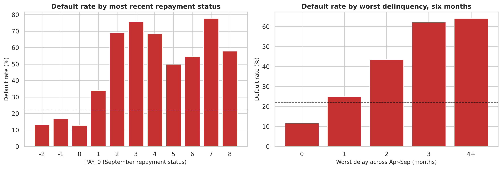

- 22.1% of clients default, so a model predicting "no default" for everyone scores 77.9% accuracy.
- Repayment status is the dominant signal: default rates are 12.8% at status 0, 33.9% at one month late and 69.1% at two.
- Default falls monotonically with credit limit (31.8% in the lowest quintile to 13.8% in the highest) and is U-shaped in age.
- The six bill-amount columns correlate at 0.80 or higher with each other.

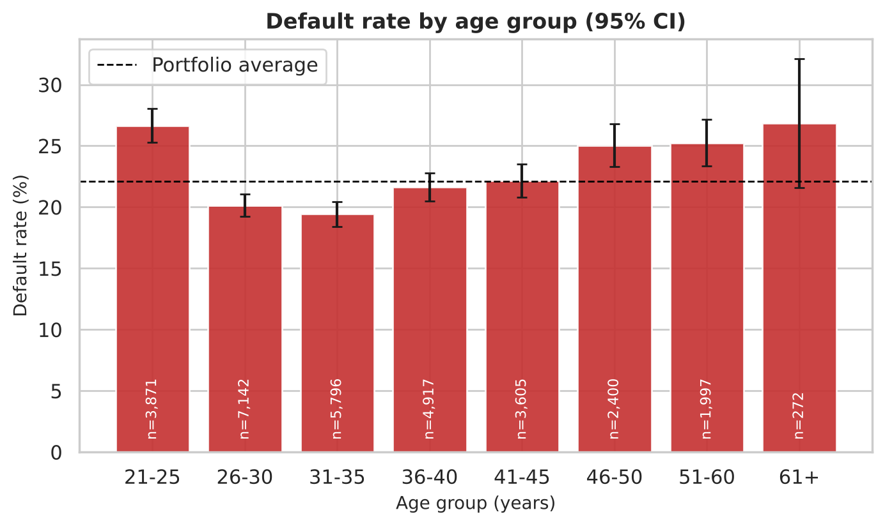
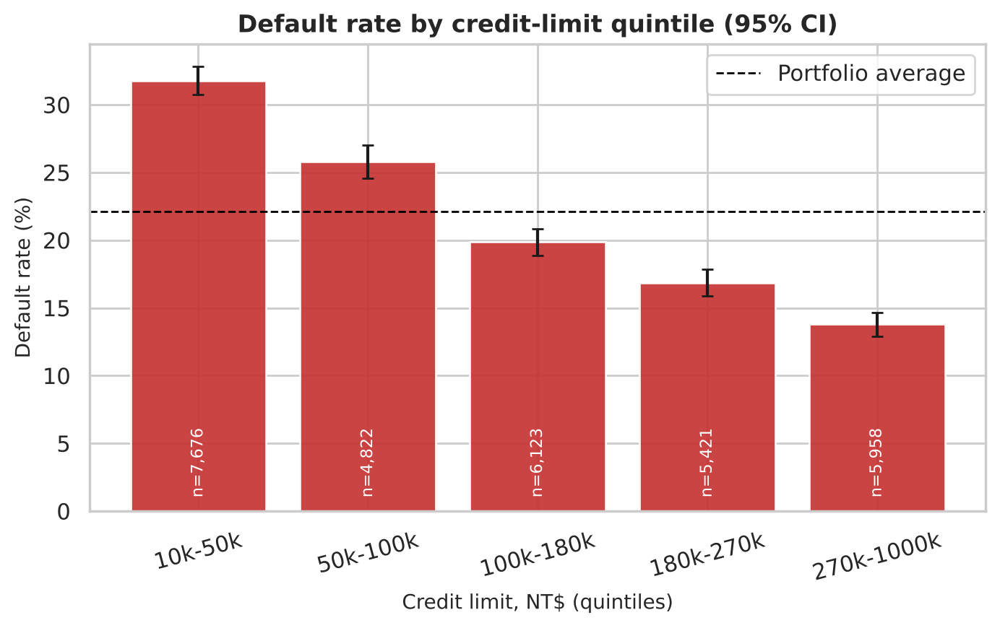

## 7. Model development
Notebooks [`02`](notebooks/02_data_preprocessing.ipynb) and [`03`](notebooks/03_logistic_regression_modelling.ipynb). Four variants: unregularised baseline, L1, L2 (regularisation strength tuned by stratified 5-fold CV ROC-AUC on the training set) and L2 with balanced class weights.

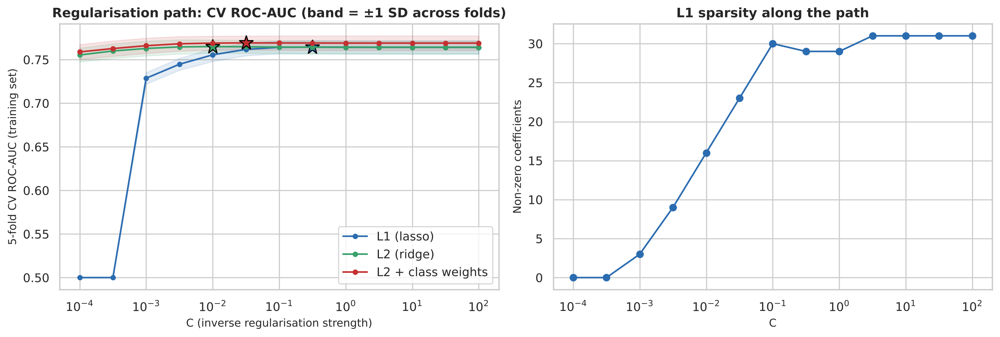

Multicollinearity after the log transform is moderate (largest VIF 9.3, for the engineered utilisation feature; base features at most 6.9).

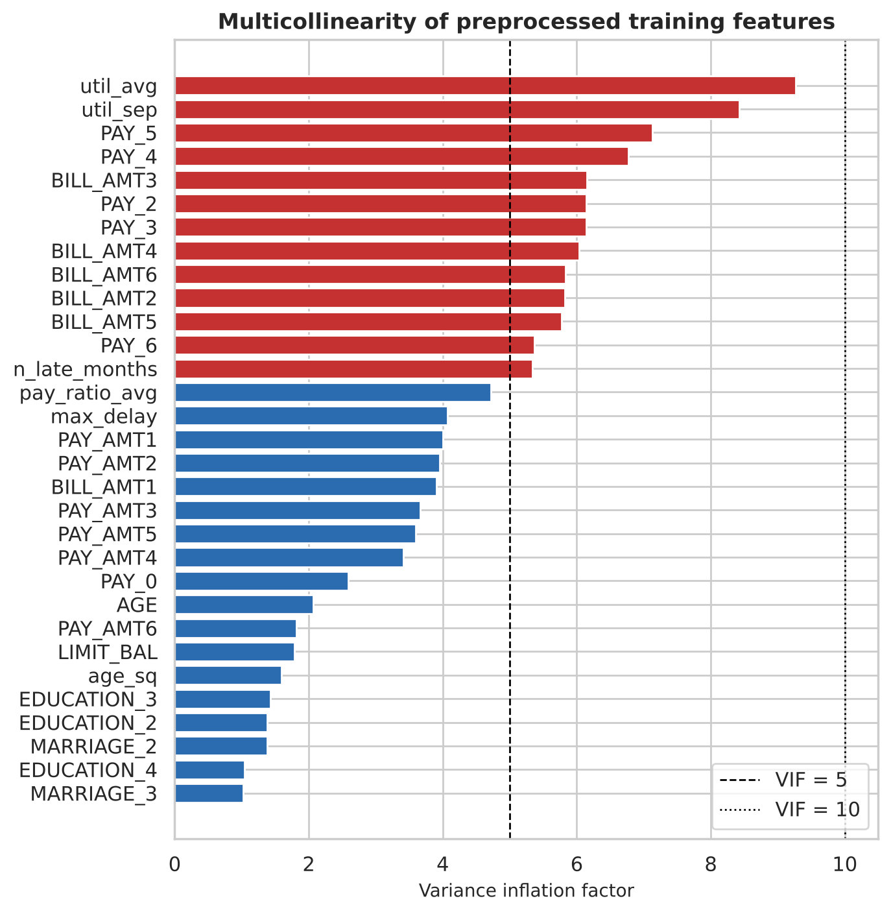

## 8. Evaluation metrics
Accuracy, precision, recall, F1, ROC-AUC, PR-AUC, Brier score, KS statistic and confusion matrices. Accuracy alone is insufficient because the majority-class baseline already scores 77.9%; the unweighted models reach about 80% accuracy while catching only 28 to 30% of defaulters at the 0.50 threshold.

## 9. Results
**Validation set (threshold 0.50)**

| Model | ROC-AUC | PR-AUC | KS | Brier | Recall | Precision |
|---|---|---|---|---|---|---|
| Baseline | 0.7478 | 0.494 | 0.381 | 0.1435 | 0.301 | 0.632 |
| L1 (C = 0.32) | 0.7482 | 0.494 | 0.381 | 0.1434 | 0.295 | 0.629 |
| **L2 (C = 0.01), selected** | 0.7501 | 0.493 | 0.385 | 0.1434 | 0.283 | 0.628 |
| L2 + class weights | 0.7552 | 0.490 | 0.388 | 0.1915 | 0.604 | 0.441 |

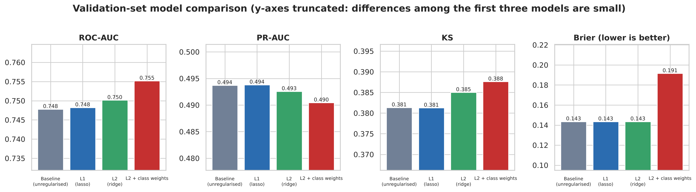
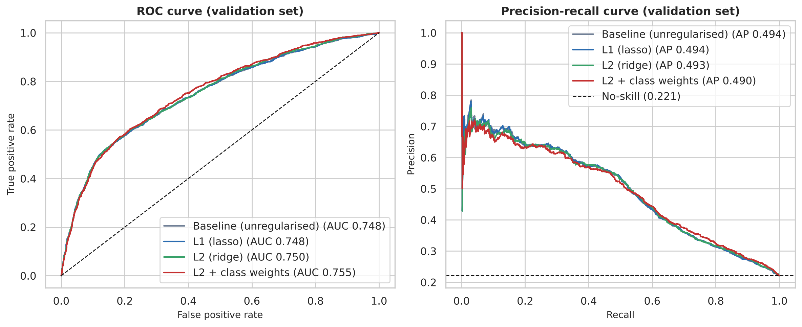

**Test set, selected L2 model (evaluated once)**

| Threshold | Accuracy | Precision | Recall | F1 | ROC-AUC | PR-AUC | KS | Brier |
|---|---|---|---|---|---|---|---|---|
| 0.50 | 0.811 | 0.663 | 0.295 | 0.409 | 0.765 | 0.520 | 0.424 | 0.139 |
| 0.13 (cost ratio 5) | 0.597 | 0.330 | 0.795 | 0.466 | 0.765 | 0.520 | 0.424 | 0.139 |

Test performance is slightly higher than validation (ROC-AUC 0.765 vs 0.750). With 6,000-row sets this difference is within sampling noise, so the validation figures are the more conservative estimate.

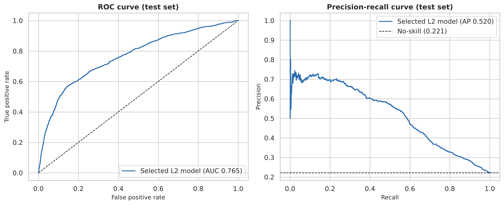
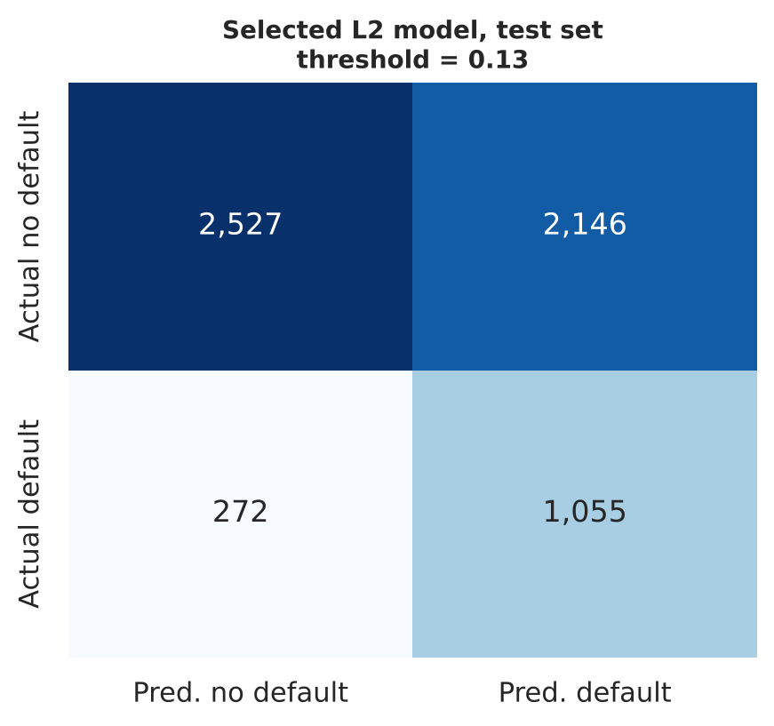

**Model-selection caveat.** The class-weighted model has the highest validation ROC-AUC. It was excluded by a rule written in advance (the PD model must produce interpretable probabilities). After Platt recalibration its Brier score matches L2 (0.1437 vs 0.1434) and its ranking advantage of 0.005 ROC-AUC has a validation bootstrap interval of 0.0027 to 0.0073. A recalibrated class-weighted model is therefore a defensible alternative; it was not evaluated on the test set.

## 10. Financial risk interpretation
Notebook [`04_credit_risk_analysis.ipynb`](notebooks/04_credit_risk_analysis.ipynb).

**Probability of default.** The model returns a one-month PD. The distribution is right-skewed (median 13.6%, 95th percentile 63%).

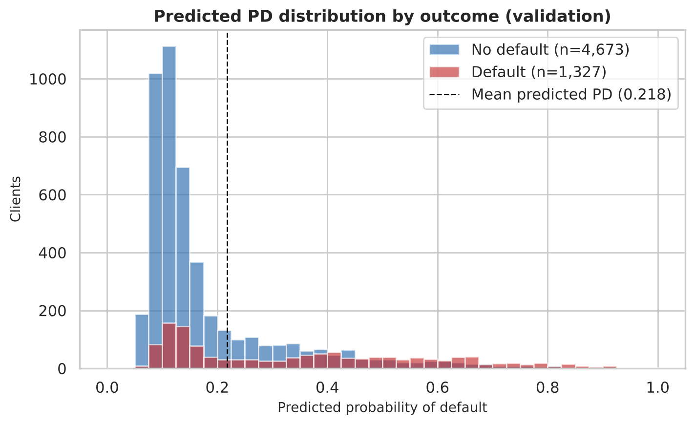

**Illustrative risk bands** (cut-offs are my own, not an institutional scale). Observed default rate rises from 7.1% to 62.8%; the 10% of clients with PD of at least 50% account for 28% of defaults.

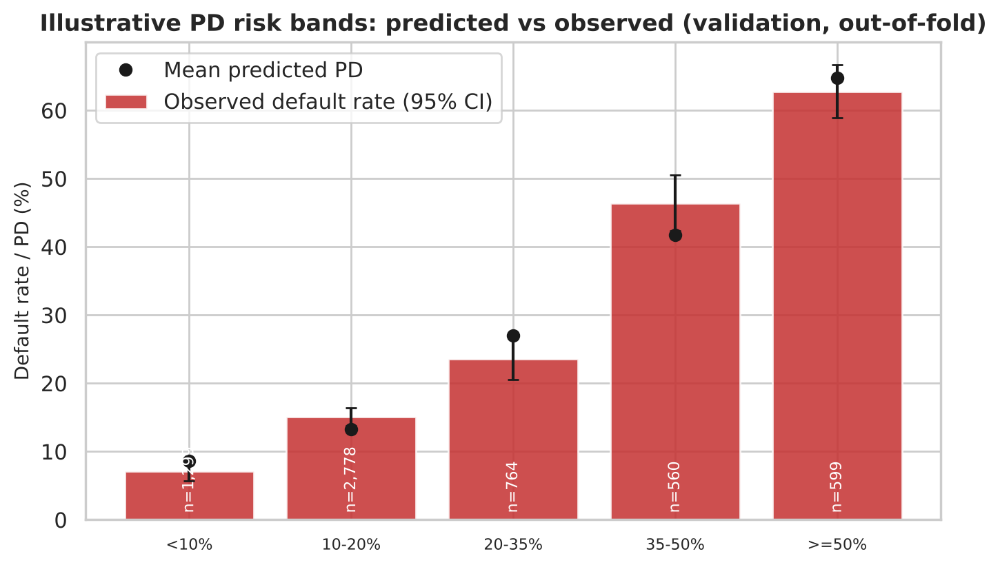

**Coefficients and odds ratios** (unregularised statsmodels logit on the same standardised features; associations, not causal effects). `n_late_months`, `PAY_0` and `max_delay` have odds ratios of 1.74, 1.39 and 1.35 per standard deviation; a previously on-time client falling one month behind moves all three, for a joint odds ratio of about 2.5. Credit limit has an odds ratio of 0.84 per standard deviation of log-limit, which partly reflects the issuer's own earlier assessment. Negative coefficients on `PAY_2` to `PAY_6` result from adjustment for the overlapping delinquency features, not from a protective effect.

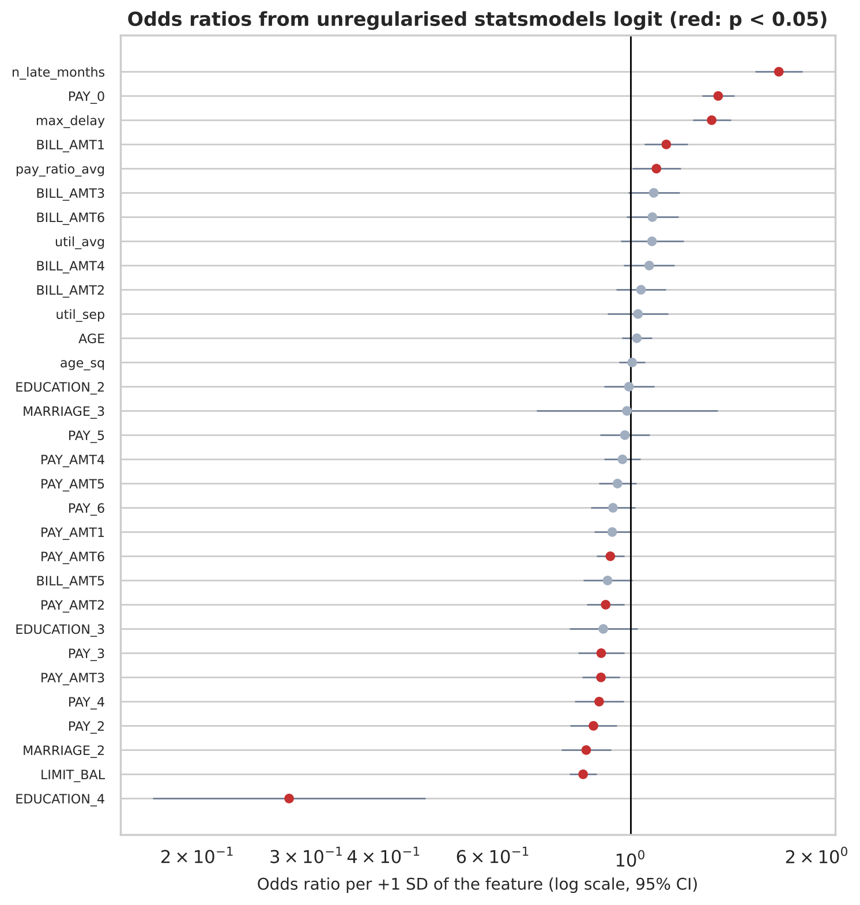

**Calibration.** The L2 model is well calibrated out of sample (test ECE 0.022). Class weighting inflates predicted PD to 43.6% until recalibrated.

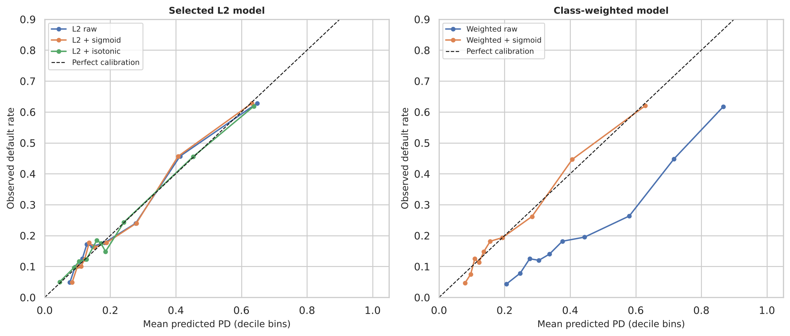

**Thresholds.** At 0.50 the model catches 28% of defaulters. The threshold that minimises cost depends on how much costlier a missed default is than a false alarm: 0.34 at 2×, 0.22 at 3.5×, 0.13 at 5× and 0.10 at 10×. The chosen 0.13 flags 54% of clients to capture 79% of defaulters at 32% precision, which suits routing accounts to review rather than automatic rejection. The cost ratio is a hypothetical input, not an estimate.

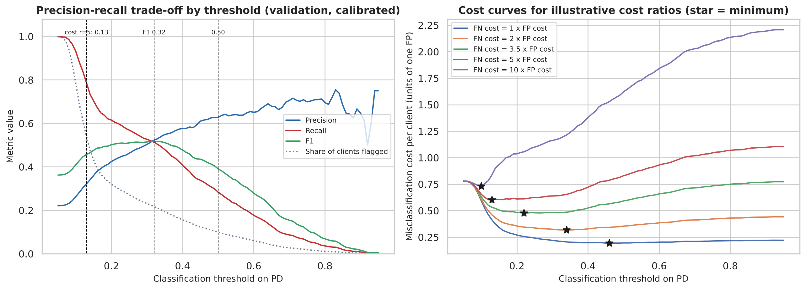

**Expected credit loss (hypothetical).** ECL = PD × LGD × EAD. The dataset contains no LGD or EAD, so actual expected loss cannot be computed. Under assumed LGD of 25 to 75% and credit conversion factors of 0 to 100%, hypothetical ECL spans 1.6% to 13.0% of the total credit limit; the spread comes from the assumptions, not from the model. The model's contribution is the ranking: clients in the top PD band are 9.8% of the test portfolio but 21% of hypothetical ECL.

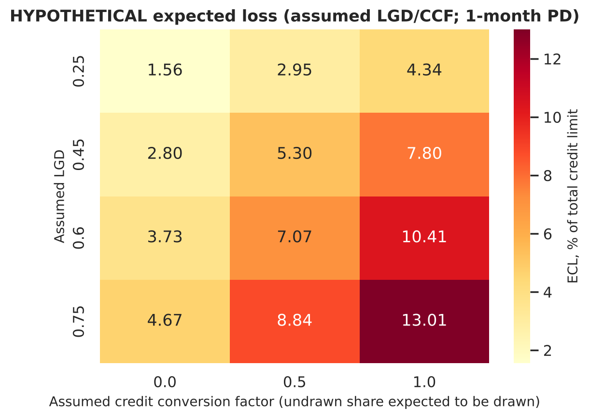

## 11. Repository structure
```
README.md  requirements.txt  run_all.sh  .gitignore  tests/
data/        README.md, raw/ (dataset downloaded here, not committed)
scripts/     download_data.py
notebooks/   01 EDA, 02 preprocessing, 03 modelling, 04 credit risk analysis
src/         data_loader.py, preprocessing.py, train.py, evaluation.py, visualisation.py
results/     figures/ (25 PNGs), model_metrics.csv, model_comparison.csv, and further result tables
models/      trained pipelines (.joblib, saved with scikit-learn 1.9; re-run notebook 03 to regenerate under another version) and selection.json
docs/        methodology.md, dataset_description.md, quality_assessment.md, cv_description.md
```

## 12. Installation
Developed on Python 3.12 with scikit-learn 1.9, pandas 3, statsmodels 0.15.
```bash
git clone <repository-url> && cd credit-risk-modelling
python -m venv .venv && source .venv/bin/activate
pip install -r requirements.txt
```

## 13. Reproducing the results
1. Download the data: `python scripts/download_data.py` (or manually, see `data/README.md`) so that `data/raw/default of credit card clients.xls` exists.
2. Run the notebooks in order (notebook 04 needs the models saved by notebook 03):
```bash
bash run_all.sh
```
or open the notebooks in Jupyter and run them top to bottom. All randomness uses seed 42. `pytest -q` runs the sanity tests. A clean-environment re-run reproduced every result table exactly (see `docs/quality_assessment.md`).

## 14. Limitations
- **One observation window.** The split is random and stratified, so stability across economic periods is untested; no out-of-time validation is possible.
- **Context.** The data come from one Taiwanese issuer in 2005, during a consumer-credit stress. The 22% default rate is far above typical card portfolios, and PDs and thresholds are not transferable.
- **Horizon.** The target is next-month default, not a 12-month or lifetime PD.
- **No LGD or EAD.** ECL results are hypothetical sensitivities.
- **Fairness.** SEX is excluded, but marital status, education and age remain and may proxy protected characteristics; no fairness audit was performed.
- **Data coding.** Undocumented codes were merged or interpreted, not verified with the data owner.
- **Statistical caveats.** Model differences among the unweighted variants are small and untested formally; p-values are uncorrected for multiple testing; the validation set was used for feature-set, model and calibration decisions, so the test set is the only unbiased estimate.
- **Feature design.** Average utilisation has a U-shaped relationship with default, so the linear term is a compromise.
- **Exploratory analysis used the full dataset.** EDA, including default rates by age, limit and category, was run on all 30,000 rows, including those later used for validation and test. It informed design choices (merging undocumented category codes, the age² term, signed-log transform, the utilisation cap and the age centre of 35). No model parameters were fitted on it, but the test set was not unseen by the analyst, which makes the test result slightly optimistic in principle.
- **Provenance.** The dataset checksum was not compared with an independently published UCI value.

## 15. Possible future improvements
- Weight-of-evidence binning and scorecard scaling, including banded utilisation.
- Time-aware validation on data with a proper date structure, plus population stability monitoring.
- Bootstrap confidence intervals for test metrics and formal tests of model differences.
- Test the recalibrated class-weighted model as the PD model.
- A fairness audit of the variables that remain.
- Real LGD and EAD data (or published benchmark parameters), a 12-month PD target and IFRS 9 staging.
- A gradient-boosting benchmark kept separate from the main logistic study, to quantify what the interpretable model gives up.
